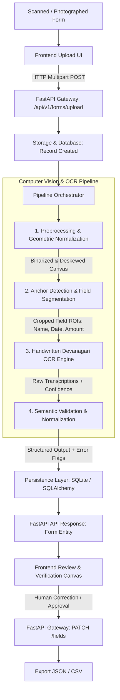

# System Architecture & Technical Specification

**Project:** Handwritten Indic-Script Form Digitiser  
**Scope:** Devanagari / Hindi handwritten document fields (Name, Date, Amount) from fixed printed form templates, architected for multi-script and variable-layout extensibility.

---

## 1. Architectural Philosophy & Design Principles

The Handwritten Indic-Script Form Digitiser is built on five core architectural tenets:

1. **Modularity & Loose Coupling**: Each stage of the digitization pipeline (preprocessing, segmentation, recognition, validation) is an independent, testable module with clearly defined inputs and outputs.
2. **Deterministic Preprocessing Before Machine Learning**: Geometric normalization, deskewing, and anchor alignment are performed using robust classical computer vision (OpenCV) before passing regions of interest (ROIs) to neural recognition models.
3. **Fail-Safe & Human-in-the-Loop (HITL)**: Machine-extracted fields include confidence scores and bounding-box coordinates. Low-confidence or invalid fields are flagged for interactive human verification and correction.
4. **Strict Separation of Concerns**: The FastAPI backend handles computation, computer vision, and persistence; the React frontend acts solely as an operational client and verification workspace.
5. **Script & Layout Extensibility**: Model registries, character dictionaries, and layout anchors are defined via configuration schemas to facilitate adding additional Indic scripts (e.g., Bengali, Gujarati, Tamil) and dynamic form layouts in future phases.

---

## 2. High-Level Data Flow



---

## 3. Module Breakdown & Responsibilities

### 3.1 Backend Architecture (`backend/app/`)

```
backend/
  app/
    api/             # REST route definitions and controllers
    core/            # Global configuration, database session, logging, constants
    schemas/         # Pydantic data transfer models & validation contracts
    preprocessing/   # Classical computer vision and image normalization
    segmentation/    # Layout analysis, fiducial registration, ROI slicing
    recognition/     # Devanagari character and sequence OCR inference
    validation/      # Domain-specific semantic checks and numeral conversion
    pipeline/        # Pipeline orchestration and telemetry
    evaluation/      # Benchmark metrics (CER, WER, Field Accuracy)
  tests/             # Pytest automated test suites
  data/              # Sample images, annotations, and debug artifacts
  scripts/           # Tooling for synthetic data generation and benchmarking
```

#### `backend/app/core/`
- **Configuration**: Uses Pydantic `BaseSettings` reading from environment variables (`.env`).
- **Database Engine**: SQLAlchemy engine and session factory (`get_db`) targeting SQLite (`form_digitiser.db`).
- **Constants**: Script definitions, Devanagari Unicode character ranges (`U+0900` to `U+097F`), Devanagari digits (`०` to `९`), and reference template anchor coordinates.
- **Logging**: Structured JSON/console logger capturing pipeline stage execution times and warnings.

#### `backend/app/schemas/`
- **Request Models**: File upload constraints, manual correction payloads (`FieldCorrectionRequest`).
- **Response Models**: `FormResponse`, `FieldResult`, `BoundingBox`, `ValidationIssue`, `HealthResponse`.
- **Enums**: `FormStatus` (`PENDING`, `PROCESSING`, `COMPLETED`, `FAILED`), `FieldType` (`NAME`, `DATE`, `AMOUNT`), `ValidationStatus` (`VALID`, `WARNING`, `ERROR`).

#### `backend/app/preprocessing/`
- **Image Ingestion**: Safe image loading from bytes using OpenCV (`cv2.imdecode`) and NumPy arrays.
- **Binarization**: Adaptive thresholding (Sauvola / Otsu) resilient to uneven lighting, paper shadows, and ink bleeding.
- **Deskewing**: Skew detection using Radon transform or Hough line accumulation; affine rotation correction.
- **Perspective Rectification**: Four-point perspective transformation aligning the photographed form to the standardized template canvas.

#### `backend/app/segmentation/`
- **Anchor / Fiducial Alignment**: Detection of printed registration marks or template header lines using OpenCV feature matching or template matching.
- **Field ROI Extraction**: Deterministic cropping of target field boxes:
  - **Name Field ROI**: Extended horizontal box supporting compound Devanagari words.
  - **Date Field ROI**: Segmented cell box or contiguous slash/hyphen delimited box.
  - **Amount Field ROI**: Currency symbol anchor followed by numeric/word field box.
- **Line & Character Analysis**: Shirorekha (horizontal headline) detection and structural segmentation when character-level slicing is required.

#### `backend/app/recognition/`
- **OCR Engine Abstraction**: Abstract base class `BaseOCREngine` with a unified `recognize(roi_image) -> OCRResult` interface.
- **Devanagari Recognition**: Sequence recognition model (CRNN with CTC decoding or attention-based encoder-decoder) trained/fine-tuned on handwritten Devanagari datasets.
- **Character Vocabulary**: Mapping support for vowels (*Swar*), consonants (*Vyanjan*), vowel signs (*Matras*), conjuncts (*Samyuktaksar*), and Devanagari numerals (`०, १, २, ३, ४, ५, ६, ७, ८, ९`).

#### `backend/app/validation/`
- **Name Validation**: Validates Unicode script conformity (ensuring characters belong to Devanagari/Hindi block), strips non-text artifacts, and applies dictionary/phonetic heuristics.
- **Date Validation**: Recognizes both Devanagari numerals (`१५/०८/२०२४`) and standard numerals (`15/08/2024`); parses standard formats (DD/MM/YYYY, DD-MM-YYYY); verifies calendar validity (days per month, leap year).
- **Amount Validation**: Converts Devanagari digits (`०-९`) to standard integers/floats; validates currency formatting; cross-validates numeric amount with written words if both are present.
- **Confidence Scoring**: Computes an aggregate field confidence score combining OCR probability and semantic rule conformity.

#### `backend/app/pipeline/`
- **Pipeline Orchestrator**: `DigitizationPipeline` executes the stages sequentially, timing each step:
  $$\text{Raw Image} \xrightarrow{\text{Preprocess}} \text{Aligned Canvas} \xrightarrow{\text{Segment}} \{\text{ROIs}\} \xrightarrow{\text{Recognize}} \{\text{Raw Text}\} \xrightarrow{\text{Validate}} \text{Validated Entity}$$
- **Intermediate Artifacts**: Optional debug persistence of preprocessed canvas and segmented ROIs for auditability and verification.

#### `backend/app/evaluation/`
- **Character Error Rate (CER)**: Levenshtein distance normalized by ground truth character count:
  $$\text{CER} = \frac{S + D + I}{N}$$
- **Word Error Rate (WER)**: Word-level edit distance.
- **Field Extraction Accuracy (FEA)**: Exact match ratio and normalized field similarity.
- **Segmentation IoU**: Intersection-over-Union between ground-truth and detected field bounding boxes.

---

### 3.2 Frontend Architecture (`frontend/`)

- **Framework**: React 19 / TypeScript initialized via Vite.
- **Styling**: Tailwind CSS with clean, modern SaaS UI aesthetics.
- **Key Views**:
  - **Document Ingestion**: Drag-and-drop zone with format validation (PNG, JPG, TIFF) and live upload progress.
  - **Document Inspection & Verification Workspace**:
    - Left Pane: Interactive high-resolution document viewer displaying detected bounding boxes overlaid on the preprocessed form.
    - Right Pane: Structured form editor displaying extracted Name, Date, and Amount fields alongside confidence badges and validation warnings.
  - **Human-in-the-Loop Correction**: In-line editing allowing human operators to amend unrecognized or low-confidence characters before finalizing.
  - **Data Export**: Structured export triggers for formatted JSON and CSV datasets.

---

## 4. Multi-Script & Variable-Layout Extensibility

To extend beyond the initial fixed-template Devanagari scope:

1. **Script Extensibility**:
   - The recognition module relies on `BaseOCREngine`.
   - Adding a new script (e.g., Bengali, Tamil) requires registering a script-specific character dictionary and model checkpoint without altering the pipeline orchestrator.
2. **Layout Extensibility**:
   - Form geometry is defined via declarative JSON layout templates (`TemplateDefinition`) containing anchor points and relative field bounding boxes.
   - Variable layouts can be matched at runtime via template fingerprinting or deep-learning-based key-value extraction models (e.g., LayoutLM / YOLO document detectors).

---

## 5. Security & Privacy Considerations

- **Tenant & File Isolation**: Form images are stored with UUID-based identifiers; no predictable filesystem paths.
- **Input Sanitization**: Strict file extension and MIME-type verification before passing image buffers to OpenCV.
- **Memory Management**: High-resolution image buffers are processed in-memory and immediately dereferenced to prevent memory leaks.
- **No Git Leaks**: All raw uploads, customer forms, generated masks, and model weights are explicitly ignored by `.gitignore`.
